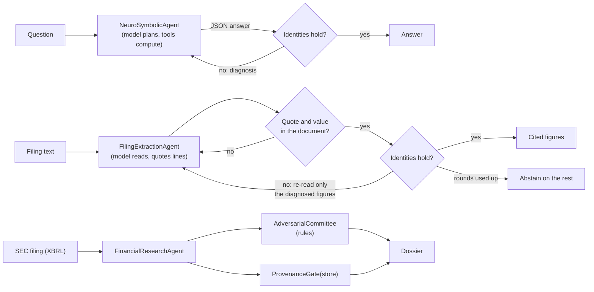

# Agents: what each one does

Līlāvatī is a tool layer. Its agents are small and, where possible, deterministic: language models
read text, plan tool calls and write prose; code computes and checks. This page describes each agent as
it is in the code, including what it does not do. New workflows built from these parts are in
[agent workflows](agent-workflows.md); every engine's validation status is in
[validation status](validation/status.md).

| Agent | Module | Language model | What it does | Checks | Status |
| :--- | :--- | :--- | :--- | :--- | :--- |
| `NeuroSymbolicAgent` | `runtime/agent.py` | yes (any provider; the default preset is a mock) | tool loop: the model requests tools, registered Python functions run them | identities on a JSON answer, with a diagnosis in the reflection prompt; tool-round and reflection limits set `completed=False` | tested with scripted models; live runs in the integrations |
| `FinancialAgent` | `framework/agent.py` | yes | wraps `NeuroSymbolicAgent` as a graph node with a role prompt | as above | tested |
| `FinancialStateGraph` and gates | `framework/` | no | runs your node functions in order or by conditional edges, with tracing | `SMTBalanceGate` (with diagnosis), `CovenantGate`, `ProvenanceGate(store)`, `TemporalPurityGate` | tested |
| `FilingExtractionAgent` | `agents/extraction.py` | yes (the extractor; any callable) | reads figures with the line each came from; re-reads only what checks name; abstains on the rest | quote in the document, value in the quote, identities with diagnosis; figures no identity involves listed as `unchecked` | tested with scripted extractors; first runs with four models on five 10-Ks: no misreadings to repair ([workflow 1](agent-workflows.md#1-extraction-with-diagnosis-driven-repair-implemented)) |
| `FinancialSearchAgent` | `agents/search.py` | no (its model argument is unused) | the latest 10-K filed by an as-of date; five figures with citations | point-in-time filter; notes instead of figures when data is missing | live on SEC; India not implemented |
| `FinancialResearchAgent` | `agents/research.py` | no | dossier from one 10-K: statement model, committee, scenario tree, citations | statement and committee identities; every citation resolved against the SEC data read | piloted live on Apple, Microsoft, Walmart, Nvidia |
| `AdversarialCommittee` | `agents/committee.py` | no | fixed rules over Beneish, Altman and identity checks; "bull", "bear" and "risk officer" are labels | balance sheet (Z3) and cash reconciliation on reported inputs | rule-based |
| `DeepFinancialAgent` | `agents/deep.py` | no (its model argument is unused) | three fixed scenarios (or supplied ones) on the statement graph, probability-weighted | prunes scenarios with negative cash or a closing balance sheet that does not balance (the graph has no plug, so this check can fail) | not reference-checked |

## What the agents do not do

- **No agent checks arithmetic written in prose.** The runtime checks identities on a JSON answer; the
  integration examples check that a final answer quotes the tool outputs (`examples/integrations/_task.py`).
  A gate that rejects numbers in an answer that no tool or source produced is proposed
  ([workflow 4](agent-workflows.md#4-answers-with-evidence-proposed)).
- **The runtime does not check citations.** Put `ProvenanceGate(store)` in a graph for that.
- **`FinancialSearchAgent` and `DeepFinancialAgent` call no model** despite accepting one; their names
  describe the task, not the method. The deep agent's "reasoning steps" are fixed descriptions of its
  steps, not text derived from the question.
- **Traces record spans, tool arguments and outputs, and identity-check results**; they do not record
  token counts or document hashes (the model client returns token usage; storing it is open).

## Choosing a component

- A question that needs calculations: `NeuroSymbolicAgent` (or LangGraph / Google ADK with the MCP
  servers, see [integrations](integrations.md)).
- Figures from a document you hold: `FilingExtractionAgent`, or `get_filing_figures` when SEC XBRL exists.
- A fixed pipeline with checks between steps: `FinancialStateGraph` with gates
  ([Tutorial 01](tutorials/01_build_your_first_financial_agent.md)).
- One company from its 10-K, as of a date: `FinancialResearchAgent`
  ([Tutorial 08, Step 6](tutorials/08_real_10k_llm_vs_lilavati.md)).
