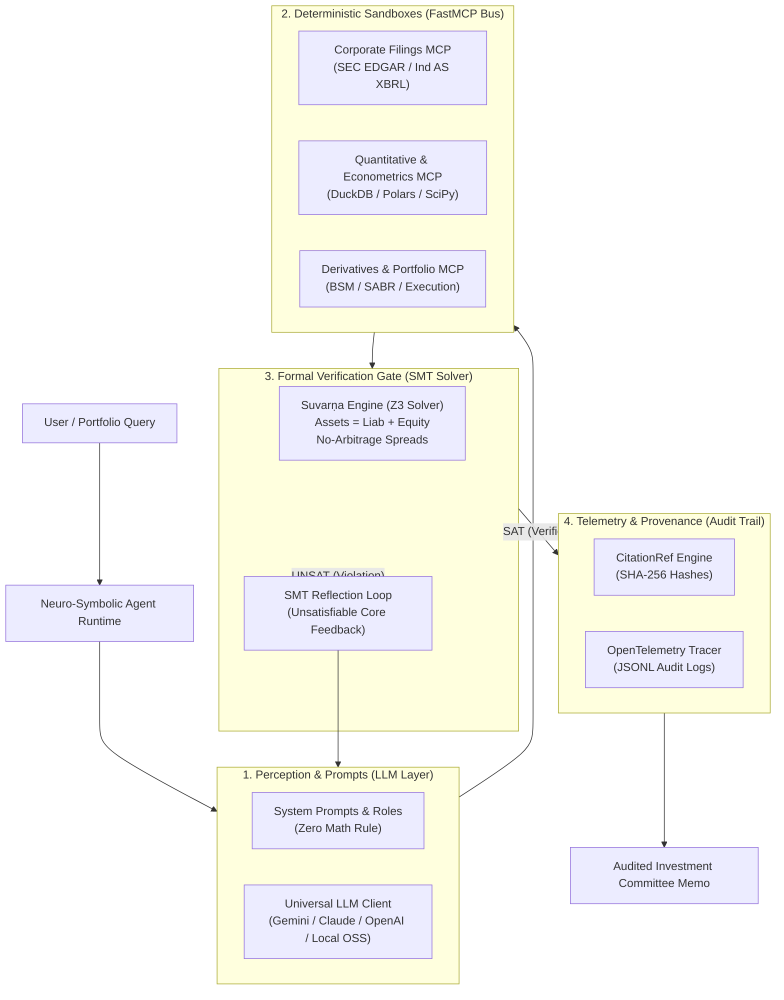

# Architecture & Runtime Specification

Project Līlāvatī decouples unstructured perception from deterministic quantitative calculation and formal verification:

---

## 1. Centralized Prompts Catalog (`src/lilavati/prompts/`)
All prompts strictly enforce institutional constraints:
- `LILAVATI_CORE_SYSTEM_PROMPT`: Prohibits mental arithmetic and demands formal tool calls.
- `BULL_RESEARCHER_PROMPT`: Directs valuation catalyst modeling.
- `FORENSIC_BEAR_PROMPT`: Directs earnings quality and Beneish M-Score audits.
- `SUSTAINABILITY_ANALYST_PROMPT`: Directs carbon accounting and transition risk.
- `PORTFOLIO_MANAGER_PROMPT`: Directs final capital allocation under SMT verification.
- `generate_smt_reflection_prompt()`: Bridges SMT solver contradictions back into the LLM context.

---

## 2. Multi-Model LLM Adapter (`src/lilavati/llm/`)
Supports seamless switching between cloud and open-source models:
- Google Gemini (`gemini-2.5-pro`, `gemini-2.5-flash`)
- Anthropic Claude (`claude-3-7-sonnet`)
- OpenAI (`gpt-4o`, `o3-mini`)
- Local Open-Source Financial Foundation Models via vLLM or Ollama (`Llama-3-Fin`, `FinMA`)

---

## 3. Telemetry, Tracing & Compliance (`src/lilavati/tracing/`)
Every agent run captures:
- OpenTelemetry-compatible `TraceSpan` records for each turn.
- Tool arguments, outputs, and execution latencies.
- SMT solver SAT/UNSAT status and violation descriptions.
- Token consumption and financial document SHA-256 hashes.
- Immutable JSONL audit file exports for compliance.

